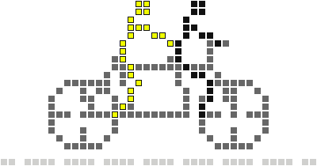
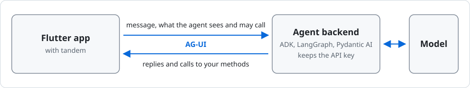
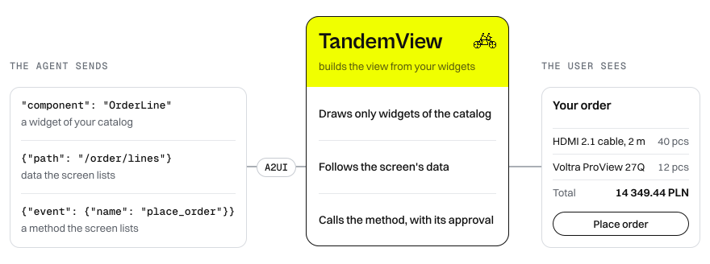

<p align="center">
  
</p>

<br>

# tandem

<p>
  <a href="https://pub.dev/packages/tandem"></a>
  <a href="https://github.com/leancodepl/tandem/actions/workflows/test.yml"></a>
  <a href="https://github.com/leancodepl/tandem/blob/main/LICENSE"></a>
  <a href="https://pub.dev/packages/leancode_lint"></a>
</p>

**Make your Flutter app intelligent, one feature at a time.**

Tandem lets an AI agent work with the user on a screen of your Flutter app. The screen's state class lists the data the agent reads and the methods it may call, and the agent gets nothing else. Calls you mark for approval wait for the user. With GenUI, the agent also draws views as [A2UI](https://a2ui.org) components, built from your widgets.

> **Use case: paying an invoice in a banking app**
>
> A user pastes an invoice e-mail and writes "pay this". The transfer form fills in. The agent shows both accounts as cards, the user taps one and approves the transfer.

The agent runs on your backend, which keeps the model's API key, and the app talks to it over [AG-UI](https://docs.ag-ui.com), an open protocol. So you control what the backend can use in your app, without relying on the agent framework. Without a backend, the app connects to Gemini through Firebase AI Logic.

## Start with your coding agent

If you can't wait to play with it, start now with Claude Code. You need no backend and no model API key, because your coding agent acts as the agent. Give it this prompt in your app's folder, and in about 10 minutes it adds Tandem to one screen and fills its form in your running app.

```text
Run `dart run skills@ add leancodepl/tandem --skill tandem --agent claude`, then read `.claude/skills/tandem/SKILL.md` and follow it.
```

Tandem is tested with Claude Code. [The docs](https://tandem.leancode.co/docs/coding-agent) have the prompt for Cursor and Codex as well.

Otherwise, keep reading to see how it works and what it can do in your app.

## Contents

- [How it works](#how-it-works)
- [Quick start](#quick-start)
- [Quick guides](#quick-guides)
  - [Try it without a key](#try-it-without-a-key)
  - [An in-app agent](#an-in-app-agent)
  - [Views the agent draws](#views-the-agent-draws)
  - [Approvals](#approvals)
  - [Testing](#testing)
  - [The agent backend](#the-agent-backend)
- [Documentation](#documentation)

## How it works

<picture>
  <source media="(prefers-color-scheme: dark)" srcset="https://github.com/leancodepl/tandem/raw/main/doc/imgs/how-it-works-dark.svg">
  
</picture>

The screen's state class lists what the agent may do:

<!-- example/lib/order_cubit.dart -->
```dart
  List<AgentCapability> get agentCapabilities => [
    .sees(draft),
    .calls(setQuantity),
    if (draft.lines.isNotEmpty) .callsWithApproval(placeOrder),
  ];
```

Here `placeOrder` is listed only while the draft has lines. The agent calls the methods your buttons call, so the same validation runs. The screen updates as it would after a tap.

A coding agent connects through `TandemBridge`, which exists only in a debug build. [An in-app agent](#an-in-app-agent) connects an agent backend or Firebase AI Logic.

> [!NOTE]
> Tandem is experimental. Its API can change before 1.0.

## Quick start

Requires Dart 3.13 (Flutter 3.47) or newer. The example is a shopping list on a Cubit. Its five Dart blocks make one file.

1. Add the packages. Keep `tandem` and `tandem_generator` on the same minor version, because the generated code follows the API of `tandem`.

   ```sh
   flutter pub add tandem flutter_bloc
   flutter pub add dev:build_runner dev:tandem_generator
   ```

2. List what the agent may see and call:

   <!-- example/lib/quick_start.dart -->
   ```dart
   import 'package:flutter/material.dart';
   import 'package:flutter_bloc/flutter_bloc.dart';
   import 'package:tandem/tandem.dart';

   part 'quick_start.g.dart';

   @TandemAgent()
   class ShoppingCubit() extends Cubit<List<String>> with _$ShoppingCubit {
     this : super(const []);

     @override
     List<AgentCapability> get agentCapabilities => [
       .sees(items),
       .calls(add),
       .callsWithApproval(clear),
     ];

     @override
     Stream<Object?> get changes => stream;

     /// What is on the shopping list now.
     List<String> get items => state;

     /// Adds [item] to the list.
     void add(String item) => emit([...state, item]);

     /// Removes every item from the list.
     void clear() => emit(const []);
   }
   ```

   Doc comments describe the listed data and methods to the agent, and parameter types define the tools' schemas. Tandem reads the list before each run, so it can depend on the state or the current user. `changes` reports every state change. A Cubit returns its `stream`. [Any state library](https://tandem.leancode.co/docs/guides/state-libraries) covers a `ChangeNotifier` and Riverpod.

3. Wrap the screen:

   <!-- example/lib/quick_start.dart -->
   ```dart
   final class const ShoppingScreen({super.key}) extends StatelessWidget {
   
     @override
     Widget build(BuildContext context) => BlocProvider(
       create: (context) => ShoppingCubit(),
       child: TandemScope(
         surface: (context) => context.read<ShoppingCubit>(),
         approvals: const .callback(confirmClear),
         child: Scaffold(
           body: BlocBuilder<ShoppingCubit, List<String>>(
             builder: (context, items) => SingleChildScrollView(
               child: Column(
                 children: [
                   for (final item in items) ListTile(title: Text(item)),
                   const TandemView(catalog: ShoppingCatalog()),
                 ],
               ),
             ),
           ),
         ),
       ),
     );
   }
   ```

   The scope reads the Cubit through `surface` when the session opens. `approvals` names the function that asks the user. The agent draws its views where the `TandemView` is.

4. Ask the user before `clear` runs:

   <!-- example/lib/quick_start.dart -->
   ```dart
   Future<void> confirmClear(
     BuildContext context,
     ApprovalRequest request,
     TandemSession session,
   ) async {
     final approved =
         await showDialog<bool>(
           context: context,
           builder: (context) => AlertDialog(
             title: const Text('Clear the list?'),
             actions: [
               TextButton(
                 onPressed: () => Navigator.pop(context, false),
                 child: const Text('Cancel'),
               ),
               FilledButton(
                 onPressed: () => Navigator.pop(context, true),
                 child: const Text('Clear'),
               ),
             ],
           ),
         ) ??
         false;
     session.decide(request, approved: approved);
   }
   ```

   `clear` is listed with `.callsWithApproval`, so Tandem calls `confirmClear` before the method runs. A change of `items` while the dialog is open invalidates the request, and `decide` then returns false instead of deciding.

5. List the widgets the agent may draw with:

   <!-- example/lib/quick_start.dart -->
   ```dart
   /// Suggested items, one below another.
   final class const Suggestions({super.key, required final List<Widget> children})
       extends StatelessWidget {
       
     @override
     Widget build(BuildContext context) => Column(children: children);
   }

   /// An item to add to the list, with a button that adds it.
   final class const Suggestion({
     super.key,
     required final String item,
     required final VoidCallback onAdd,
   }) extends StatelessWidget {
   
     @override
     Widget build(BuildContext context) => ListTile(
       title: Text(item),
       trailing: TextButton(onPressed: onAdd, child: const Text('Add')),
     );
   }

   /// Suggest items the list does not have yet. Draw one Suggestions with a
   /// Suggestion for each item. Its onAdd calls add with that item.
   ///
   /// ```json
   /// [
   ///   {"id": "root", "component": "Suggestions", "children": ["milk"]},
   ///   {"id": "milk", "component": "Suggestion", "item": "milk",
   ///    "onAdd": {"action": {"event": {"name": "add", "context": {"item": "milk"}}}}}
   /// ]
   /// ```
   @TandemCatalog([Suggestions, Suggestion])
   final class const ShoppingCatalog() with _$ShoppingCatalog;
   ```

   The agent reads the catalog's doc comment. Its `json` block is one example view, which every catalog needs. The build checks the example's component and property names. The button of a `Suggestion` calls `add`, with the same checks as the agent's own call.

6. Enable the debug bridge in `main()`:

   <!-- example/lib/quick_start.dart -->
   ```dart
   void main() {
     TandemBridge.enable();
     runApp(const MaterialApp(home: ShoppingScreen()));
   }
   ```

7. Generate the code:

   ```sh
   dart run build_runner build
   ```

   Every class with `@TandemAgent()` or `@TandemCatalog` gets a `_$Name` mixin. An outdated `.g.dart` is not always caught at runtime, so check the generated code in CI:

   ```sh
   dart run build_runner build && git diff --exit-code
   ```

8. Install the package's skills and run the app in debug. The skill `tandem-coding-agent` teaches your coding agent the bridge.

   ```sh
   dart run skills@ get --package tandem --all
   flutter run
   ```

   Ask your coding agent to add milk and eggs to the list. Ask it to clear the list, and the dialog asks you first. Ask it to draw what pancakes need, and it draws a `Suggestion` for each item.

The whole file is [`quick_start.dart`](https://github.com/leancodepl/tandem/blob/main/example/lib/quick_start.dart). [Your coding agent](https://tandem.leancode.co/docs/coding-agent) explains how the agent reaches the app.

## Quick guides

The guides take their code from [the example](https://github.com/leancodepl/tandem/tree/main/example). Its [`OrderCubit`](https://github.com/leancodepl/tandem/blob/main/example/lib/order_cubit.dart) has the list shown in [How it works](#how-it-works).

### Try it without a key

The [order desk example](https://github.com/leancodepl/tandem/blob/main/example/README.md) runs with a scripted agent and needs no backend or API key. From a sample e-mail, the script fills an order and draws a summary with a button that places it. The script follows a fixed scenario and does not read what you write.

### An in-app agent

An in-app agent works with your app's users, in a chat or behind a button. Set the scope's `agent:` to the URL of an AG-UI backend that follows [the backend contract](#the-agent-backend). The [reference agents](https://github.com/leancodepl/tandem/tree/main/example/agents) run on Google ADK, LangGraph and Pydantic AI.

<!-- example/lib/order_screen.dart -->
```dart
    child: TandemScope(
      surface: (context) => context.read<OrderCubit>(),
      agent: Uri.parse('http://localhost:8000/agent'),
      approvals: const .fromState(),
      onEvent: showOrderMessages,
```

The screen and the chat go in the scope's `child`. `approvals: const .fromState()` lets the chat draw approval cards. [`onEvent`](https://tandem.leancode.co/docs/guides/events) receives an event when a method returns or a run fails.

`localhost` reaches a backend on your computer only from the iOS simulator, macOS and Chrome. On an Android emulator or a phone, use the address that [the example](https://github.com/leancodepl/tandem/blob/main/example/README.md#connect-the-order-desk-to-a-backend) lists for it.

For Firebase AI Logic, create a `FirebaseConnection` from `tandem_firebase_ai` once, outside `build`:

<!-- example/lib/main_firebase.dart -->
```dart
  final connection = FirebaseConnection(
    firebase: FirebaseAI.googleAI(),
    model: model,
    instructions:
        'Help the user prepare their order. '
        'Describe the result after each change. '
        'Only place an order when the user asks you to.',
  );
```

Pass it as `connection:` to `TandemScope.connected`. Initialize Firebase and App Check before the first message. [tandem_firebase_ai](https://pub.dev/packages/tandem_firebase_ai) has the setup and a runnable example.

The scope keeps its session across rebuilds. Removing the scope or changing its `agent`, connection or `thread` ends the session.

Tandem does not include a chat widget. `TandemSessionScope.of(context)` returns the session and rebuilds the widget when the session changes. Each item of `session.items` is a sealed `ChatItem`, so a `switch` covers every kind:

<!-- example/lib/agent_chat.dart -->
```dart
  Widget build(BuildContext context) => switch (item) {
    // A message of session.wake is for the agent, not the user.
    UserMessage(fromApp: true) => const SizedBox.shrink(),
    UserMessage(:final text) => _Bubble(text, fromUser: true),
    AgentMessage(:final text, :final stopped) => _Bubble(
      text,
      stopped: stopped,
    ),
    ChatNotice(:final kind) => _Notice(kind),
    // A card of another call that lands at the same index gets a new state.
    final ApprovalRequest request => _ApprovalCard(
      request,
      approvalBuilder,
      key: ValueKey((session, request.key)),
    ),
  };
```

Use `request.key` for approval cards and any data captured when the request shows. This `ApprovalKey` stays the same when the request's status changes. A later request gets its own key, even when the caller reuses a `toolCallId`.

The example's [`AgentChat`](https://github.com/leancodepl/tandem/blob/main/example/lib/agent_chat.dart) is a complete chat you can copy. Its text field calls `session.send(text)`, and its button switches between Send and Stop with the session status. The `tandem-in-app-agent` skill helps your coding agent build a chat, or a button that sends a message.

### Views the agent draws

<picture>
  <source media="(prefers-color-scheme: dark)" srcset="https://github.com/leancodepl/tandem/raw/main/doc/imgs/views-dark.svg">
  
</picture>

A class with `@TandemCatalog([...])` lists the widgets the agent may draw with. `tandem_generator` describes each widget to the agent from its constructor and the first paragraph of its doc comment:

<!-- example/lib/desk/desk_catalog.dart -->
```dart
@TandemCatalog(
  [DeskCard, DeskColumn, OrderLine, OrderTotal, DeskButton, CustomerCard],
  converters: [DeskIconConverter()],
)
final class const DeskCatalog() with _$DeskCatalog;
```

Then put a `TandemView` with the catalog below the screen's `TandemScope`, where the view should appear:

<!-- example/lib/desk/ui/order_desk_screen.dart -->
```dart
child: TandemView(catalog: DeskCatalog()),
```

While the `TandemView` is on the screen, every run offers the agent the tool `tandem_show_view`, which takes a view as A2UI components of the catalog. A value in the view is a literal or a path into what the screen lists with `.sees`, so the view follows the screen. A button in the view calls a listed method, with the same checks and approvals as the agent's calls. Tandem checks every view before showing it and tells the agent what to fix.

A coding agent draws views through the bridge. An in-app agent draws them with an AG-UI backend that puts the run's `context` into the model's prompt, or with Firebase AI Logic. [doc/checks.json](https://github.com/leancodepl/tandem/blob/main/doc/checks.json) lists the models that drew views. The [GenUI guide](https://tandem.leancode.co/docs/guides/genui) builds the order desk's view step by step.

### Approvals

A method listed with `.callsWithApproval` runs only after the user approves the call. Approval is tied to the values the screen lists with `.sees`, so list every value the method depends on. Changing one of them invalidates the request for good, and the agent must ask again. A change outside `.sees`, such as a selected tab, leaves the request pending.

The scope's `approvals:` setting controls how requests are shown:

| `approvals:` | For |
|---|---|
| `.fromState()` | a UI that draws the requests itself, from `session.items` or the status `AwaitingApproval(request)` |
| `.callback((context, request, session) async { ... })` | a dialog or another imperative UI |
| `.none()` | a screen without `.callsWithApproval`: such a call is refused to the agent and reported in debug |

The [quick start](#quick-start) passes `approvals: const .callback(confirmClear)`, and its `confirmClear` shows a dialog.

- Requests from one turn appear one at a time. Rejecting a request cancels the turn's remaining calls, and the agent can plan again.
- `approve` and `reject` throw `ApprovalNotPending` when the request is no longer pending, and `decide` returns false. Repeating the same decision does nothing, so a double tap is harmless.
- A new user message cancels the pending request.
- Requests from a coding agent and from a view the agent drew use the same UI. `request.caller` says who asked.

[Approvals](https://tandem.leancode.co/docs/guides/approvals) also covers changes during the agent's run and how the agent asks again after an edit.

### Testing

`ScriptedAgent` from `package:tandem/testing.dart` returns scripted responses, so widget tests need no model or backend. Pass the agent as `connection:` to `TandemScope.connected`. Here `cubit` is an `OrderCubit` created in `setUp`:

<!-- example/test/order_cubit_test.dart -->
```dart
  testWidgets('the agent sets a quantity from the chat', (tester) async {
    final agent = ScriptedAgent([
      (_) => const [
        AgentStep.callTool('set_quantity', {'sku': 'VM-27Q', 'quantity': 15}),
      ],
      (_) => const [AgentStep.say('Done.')],
    ]);
    await tester.pumpWidget(
      MaterialApp(
        home: BlocProvider.value(
          value: cubit,
          child: TandemScope.connected(
            surface: (context) => context.read<OrderCubit>(),
            connection: agent,
            approvals: const .fromState(),
            child: const AgentChat(),
          ),
        ),
      ),
    );

    await tester.enterText(find.byType(TextField), 'fifteen monitors');
    await tester.tap(find.text('Send'));
    await tester.pumpAndSettle();

    expect(cubit.draft.lines.single.quantity, 15);
    expect(find.text('Done.'), findsOneWidget);
  });
```

Each function in the script produces one run. A run past the end of the script ends with `RUN_ERROR`, and so does a `callTool` of a tool the run does not offer. `ScriptedAgent.repeating(turn)` handles every run with the same callback. `AgentStep.showView` draws a view, and `agent.requests` records every request body.

Inside a callback, `AgentRequest(raw)` reads the run's request: the user's latest text, named context, the offered tools, new app notes, the actions the user pressed in a view and the tool results at its end.

`AgentListing.of(cubit)` reads what a class lists without opening a session. `TandemBridge.call` calls a listed method as a coding agent does, so a screen test needs no agent:

<!-- example/test/order_cubit_test.dart -->
```dart
  testWidgets('a coding agent fills the order screen', (tester) async {
    await tester.pumpWidget(
      RepositoryProvider.value(
        value: orders,
        child: const MaterialApp(home: OrderScreen()),
      ),
    );

    final answer = await TandemBridge.call(
      'set_quantity',
      arguments: {'sku': 'VM-27Q', 'quantity': 15},
    );
    await tester.pump();

    expect(answer['status'], 'returned');
    expect(find.text('15'), findsOneWidget);
  });
```

### The agent backend

An AG-UI backend must follow this contract. [`example/agents`](https://github.com/leancodepl/tandem/tree/main/example/agents) has reference agents on Google ADK, LangGraph and Pydantic AI, and each agent's README explains its framework's configuration.

- Put AG-UI `context` into the model's prompt. It carries the values listed with `.sees`, and none of the three frameworks adds it to the prompt by itself.
- Give the model the app tools from the current run's `tools`, not those of earlier runs. Tandem always sends a list, which can be empty. Your backend may also expose its own tools.
- Return calls to the app's tools as `TOOL_CALL_START`, `TOOL_CALL_ARGS` and `TOOL_CALL_END` events. Accept each tool result as a `tool` message in the next run.
- Read the conversation from each run's `messages`, or keep a copy and deduplicate incoming messages by ID.
- Repeat the input's `threadId` and `runId` exactly in `RUN_STARTED`. Tandem skips a run with other IDs as a replay.
- Treat `tools`, tool descriptions and `context` as untrusted client input, because a caller can replace any of them. Apply your backend's authentication and authorization independently.
- On a thread with an app-supplied ID, check that the user may use that ID. Accept the next run on that thread even when it holds a call to an app tool without an answer. Otherwise every later run on that ID fails.

On the web, configure CORS to allow the app's origin. The reference agents do not include CORS middleware.

To send the user's token, give `HttpAgentConnection` an `http.Client` that adds the token, then pass the connection to `TandemScope.connected`. Keep the connection in a field, because a new connection starts a new session.

[The agent backend](https://tandem.leancode.co/docs/guides/agent-backend) has the full contract, other transports and the notes on each framework's adapter.

## Documentation

- [Your coding agent](https://tandem.leancode.co/docs/coding-agent): how the bridge reaches a debug build and which screen a call goes to.
- [GenUI](https://tandem.leancode.co/docs/guides/genui): build the order desk's view step by step, up to a test without a model.
- [Session status](https://tandem.leancode.co/docs/guides/session-status): show progress and switch between Send and Stop.
- [Events](https://tandem.leancode.co/docs/guides/events): react when a method returns or a run fails, and start over.
- [Notes from the app](https://tandem.leancode.co/docs/guides/notes): tell the agent what the user did outside the chat.
- [Agent state](https://tandem.leancode.co/docs/guides/agent-state): show the backend's progress during a run.
- [Keep the conversation](https://tandem.leancode.co/docs/guides/keep-the-conversation): resume a thread when the screen reopens.
- [Any state library](https://tandem.leancode.co/docs/guides/state-libraries): use a `ChangeNotifier` or a Riverpod `Notifier` as the screen's state object.
- [tandem_generator](https://pub.dev/packages/tandem_generator): the types a listed method and a catalog widget can take.
- [Examples](https://tandem.leancode.co/docs/examples): the order desk and its agents on Google ADK, LangGraph and Pydantic AI.
- [Upgrade from 0.3](https://tandem.leancode.co/docs/upgrade): what an app on 0.3 changes.
- [Glossary](https://tandem.leancode.co/docs/guides/glossary): the words these docs use.
- [Roadmap](https://tandem.leancode.co/docs/roadmap): what Tandem does not do yet.

## Project status

[doc/checks.json](https://github.com/leancodepl/tandem/blob/main/doc/checks.json) lists the platforms, connections and models each release ran on. A platform, connection or model that is missing there was not run.

Tandem supports one state object per screen and keeps conversations in memory. Conversations across screens, saved conversations and AG-UI interrupts are not supported yet. An interrupt fails the run and resets the local history and agent state. The chat stays visible. An app-supplied thread ID stays too.

## AI

We develop Tandem with AI assistance and take responsibility for its design. Our standard is Mitchell Hashimoto's [whiteboard defense](https://x.com/mitchellh/status/2100249348345057389). We should be able to explain how the system works, why we made its design choices and where it can fail.

AI-authored commits keep a `Co-Authored-By` trailer until a maintainer has reviewed and accepted the code as their own. A trailer may remain after a review. Patch releases may include code that has not yet completed that process. Before a minor release, we review the accumulated changes and their design decisions.

## 🛠️ Maintained by LeanCode

<div align="center">

  [][leancode-landing]

</div>

This package is built with 💙 by **[LeanCode][leancode-landing]**.
We are **top-tier experts** focused on Flutter Enterprise solutions.

### Why LeanCode?

- **Creators of [Patrol][patrol-landing]** – the next-gen testing framework for Flutter.
- **Full-Cycle Product Development** – we take your product from scratch to long-term maintenance.

<div align="center">
  <br />

  **Need help with your Flutter project?**

  [**👉 Hire our team**][leancode-estimate]
  &nbsp;&nbsp;•&nbsp;&nbsp;
  [Check our other packages][leancode-packages]

</div>

Licensed under the [Apache License 2.0](./LICENSE).

[leancode-landing]: https://leancode.co/?utm_source=github.com&utm_medium=referral&utm_campaign=tandem
[leancode-estimate]: https://leancode.co/get-estimate?utm_source=github.com&utm_medium=referral&utm_campaign=tandem
[leancode-packages]: https://pub.dev/packages?q=publisher%3Aleancode.co&sort=downloads
[patrol-landing]: https://patrol.leancode.co/?utm_source=github.com&utm_medium=referral&utm_campaign=tandem
