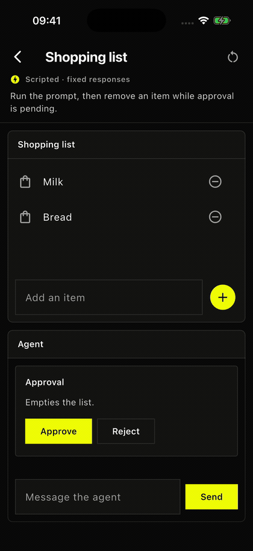
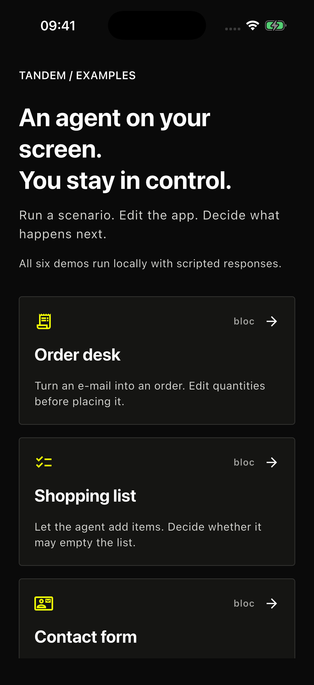
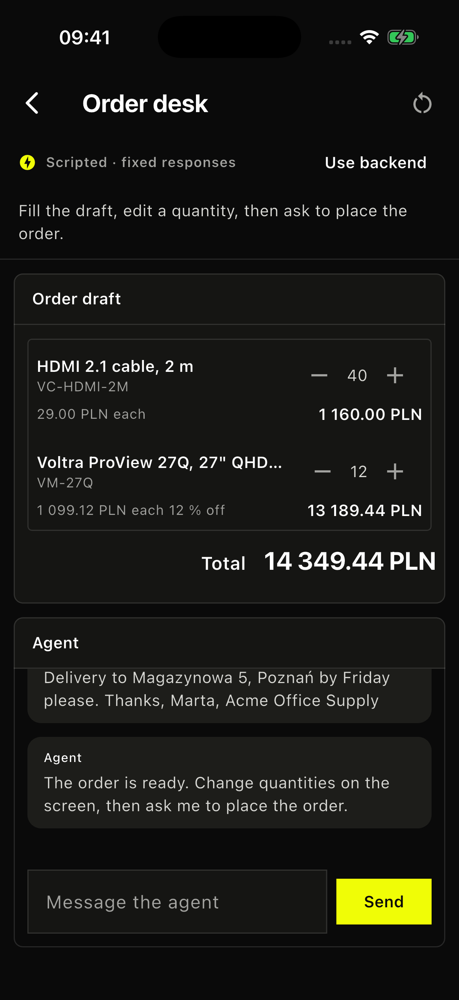
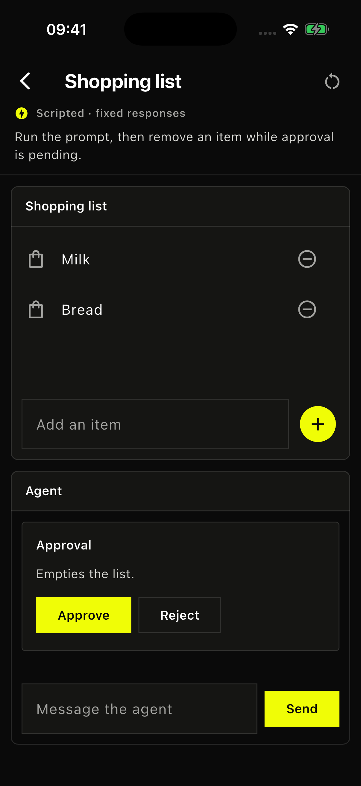
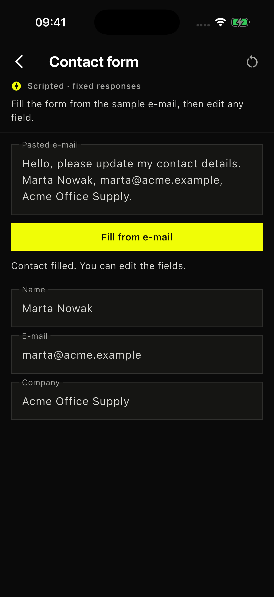

# Tandem examples

Six screens on bloc, Riverpod and provider, in one gallery app. Edit the screen yourself, let the
agent act, and see when an approval request is invalidated. Every screen starts with a scripted
agent, without a backend or an API key.

<p align="center">
  
</p>

## Run the gallery

With [FVM](https://fvm.app/) and your platform's Flutter tooling, from the repository root:

```sh
fvm flutter pub get
cd example
fvm flutter run
```

Choose an iOS simulator, an Android emulator or a connected device. For desktop, run
`fvm flutter run -d macos`.

Pick a screen and tap its suggested prompt or button. **Reset example** starts it again with fresh
state and a new session. The scripted agents follow the scenario and do not read what you write.

| Screen | Try it | Source |
|---|---|---|
| Order desk | Fill an order from the sample e-mail, change quantities, then ask to place it. Edit again while the approval is pending. | [bloc](lib/desk) |
| Shopping list | Let the agent add items, then approve emptying the list, or remove an item to invalidate the request. | [bloc](lib/shopping_list/shopping_list.dart) |
| Contact form | Fill the form from the sample e-mail, then edit the fields yourself. No chat. | [bloc](lib/recipes/fill_from_email) |
| Reply approval | Let the agent answer a customer, then send or cancel the reply in a dialog. Sending is simulated. | [bloc](lib/recipes/approval_dialog) |
| Shopping cart | Remove an item before you approve checkout, then ask again with the new cart. Checkout is simulated. | [Riverpod](lib/recipes/riverpod) |
| To-do list | Add a task while the approval is pending, then ask again to clear the list. | [provider](lib/recipes/change_notifier) |

<p align="center">
  
  
  
  
</p>

[doc/examples.md](../doc/examples.md) explains each screen. [`AgentChat`](lib/agent_chat.dart) is
the chat to copy into your app and make your own. [`demo_agents.dart`](lib/gallery/demo_agents.dart)
holds the scripts.

## Connect the order desk to a backend

In `example/agent`, with [uv](https://docs.astral.sh/uv/), start the Google ADK backend with its
scripted model, which needs no API key:

```sh
TANDEM_FAKE_LLM=1 uv run order-agent
```

In the gallery, open **Order desk**, tap **Use backend** and enter the agent's URL:

- iOS simulator, or macOS on the same Mac: `http://localhost:8000/agent`.
- Android emulator: `http://10.0.2.2:8000/agent`.
- Physical device: your computer's address on the local network. Start the backend with
  `TANDEM_HOST=0.0.0.0 TANDEM_FAKE_LLM=1 uv run order-agent` and allow port 8000 through your
  firewall. See [the backend settings](agent/README.md#configuration).

Then tap the sample e-mail. Connecting or resetting starts a new order. **Use script** goes back to
the scripted agent. The rest of the script is in [agent/README.md](agent/README.md#the-script).

For Gemini, copy `agent/.env.example` to `agent/.env`, set `GOOGLE_API_KEY` in it, and run
`uv run order-agent` in `example/agent`.

## Other platforms

In `example`, generate the host for your platform, such as Windows:

```sh
fvm flutter create --empty --platforms=windows .
fvm flutter run -d windows
```

For Linux, use `linux`. For a browser, use `--platforms=web` and `-d chrome`. The example backend
has no CORS middleware, so a browser build cannot reach it without adding one.

## Run the shopping list with Apple's on-device model

```sh
fvm flutter run -d macos -t lib/recipes/on_device/apple.dart
```

For an iPhone, select it instead of `macos`. Unlike the gallery's scripts, this asks the real model. [Requirements and limits](../README.md#apples-on-device-model).

## Smart invoice input with Apple's on-device model

```sh
fvm flutter run -d macos -t lib/recipes/on_device/invoice_demo.dart
```

An invoice list with a search field. Search for `May invoice` and four invoices match their titles. Turn on smart input with the brain, enter `Archive invoices issued in May` and press Return. Now six invoices match by their issue date, two of them without May in the title. Nothing is archived until you choose **Archive**, and **Undo** brings the invoices back.

The model only reports what the sentence asks for, through one method with a typed argument for each part. The app decides what it supports and finds the invoices. It supports invoices issued in one month and answers anything else with a hint. Each command starts a new session. The model can misread a request, so the card shows what the app found before anything changes. [Requirements and limits](../README.md#apples-on-device-model).
