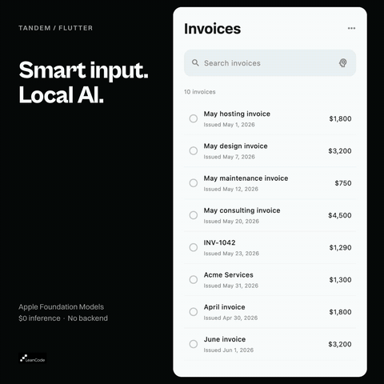

# Tandem examples

Two examples in one app. The order desk runs with a scripted agent, without a backend or an API
key. The invoice list runs on Apple's on-device model.

## Run the order desk

<p align="center">
  
</p>

With [FVM](https://fvm.app/) and your platform's Flutter tooling, from the repository root:

```sh
fvm flutter pub get
cd example
fvm flutter run
```

Choose an iOS simulator, an Android emulator or a connected device. For desktop, run
`fvm flutter run -d macos`.

Tap the sample e-mail in the chat, and the agent fills the order. Change a quantity, then ask it to
place the order. Edit again while the approval is pending. **Reset example** starts over with a new
order and a new session. The scripted agent follows the scenario and does not read what you write.

The order desk is on bloc, in [lib/desk](lib/desk), and [`order_desk_agent.dart`](lib/desk/order_desk_agent.dart)
holds its script. [`AgentChat`](lib/agent_chat.dart) is the chat to copy into your app and make your
own. The app enables `TandemBridge`, so your coding agent can fill the order too. The code of the
[README](../README.md) is a smaller order form, in [`order_cubit.dart`](lib/order_cubit.dart) and
[`order_screen.dart`](lib/order_screen.dart), with its tests.

## Connect the order desk to a backend

In `example/agent`, with [uv](https://docs.astral.sh/uv/), start the Google ADK backend with its
scripted model, which needs no API key:

```sh
TANDEM_FAKE_LLM=1 uv run order-agent
```

Tap **Use backend** and enter the agent's URL:

- iOS simulator, or macOS on the same Mac: `http://localhost:8000/agent`.
- Android emulator: `http://10.0.2.2:8000/agent`.
- Physical device: your computer's address on the local network. Start the backend with
  `TANDEM_HOST=0.0.0.0 TANDEM_FAKE_LLM=1 uv run order-agent` and allow port 8000 through your
  firewall. See [the backend settings](agent/README.md#configuration).

Then tap the sample e-mail. Connecting or resetting starts a new order. **Use script** goes back to
the scripted agent. The rest of the script is in [agent/README.md](agent/README.md#the-script).

For Gemini, copy `agent/.env.example` to `agent/.env`, set `GOOGLE_API_KEY` in it, and run
`uv run order-agent` in `example/agent`.

## Smart invoice input with Apple's on-device model

<p align="center">
  
</p>

```sh
fvm flutter run -d macos -t lib/main_apple.dart
```

For an iPhone, select it instead of `macos`. Unlike the order desk's script, this asks the real
model.

An invoice list with a search field. Search for `May invoice` and four invoices match their titles. Turn on smart input with the brain, enter `Archive invoices issued in May` and press Return. Now six invoices match by their issue date, two of them without May in the title. Nothing is archived until you choose **Archive**, and **Undo** brings the invoices back.

The model only reports what the sentence asks for, through one method with a typed argument for each part. The app decides what it supports and finds the invoices. It supports invoices issued in one month and answers anything else with a hint. Each command starts a new session. The model can misread a request, so the card shows what the app found before anything changes. [Requirements and limits](../README.md#apples-on-device-model).

## Other platforms

In `example`, generate the host for your platform, such as Windows:

```sh
fvm flutter create --empty --platforms=windows .
fvm flutter run -d windows
```

For Linux, use `linux`. For a browser, use `--platforms=web` and `-d chrome`. The example backend
has no CORS middleware, so a browser build cannot reach it without adding one.
