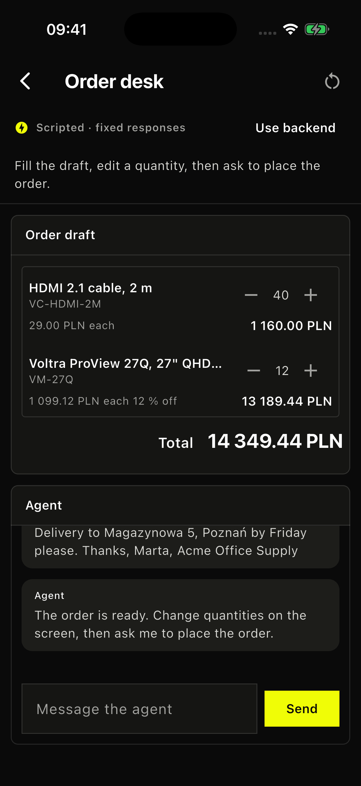

# Tandem example

The order desk runs with a scripted agent, without a backend or an API key.

## Run the order desk

<p align="center">
  
</p>

With [FVM](https://fvm.app/) and your platform's Flutter tooling, from the repository root:

```sh
fvm flutter pub get
cd example
fvm flutter run
```

Choose an iOS simulator, an Android emulator or a connected device. On macOS, run
`fvm flutter run -d macos`. In Chrome, run `fvm flutter run -d chrome`.
Apple builds of this example require Xcode 26.2 or later for the Firebase SDK.
The example targets iOS 15 and macOS 12.

Tap the sample e-mail in the chat, and the agent fills the order and draws a summary below it with
`TandemView` and the desk's own widgets. Change a quantity, then place the order from the summary or
ask the agent to. Edit again while the approval is pending: when the agent asked, it asks again a second after your
last edit. **Reset example** starts over with a new
order and a new session. The scripted agent follows the scenario and does not read what you write.

The order desk is on bloc, in [lib/desk](lib/desk), and [`order_desk_agent.dart`](lib/desk/order_desk_agent.dart)
holds its script. It uses `ScriptedAgent.repeating` with `AgentRequest` to read the order, offered
tools, answers and pressed actions from each run. [`AgentChat`](lib/agent_chat.dart) is the chat to copy
into your app and make your own. The app enables `TandemBridge`, so your coding agent can fill the
order too. The [README](../README.md) takes its quick start from
[`quick_start.dart`](lib/quick_start.dart) and its order form from
[`order_cubit.dart`](lib/order_cubit.dart) and [`order_screen.dart`](lib/order_screen.dart), each
with its tests.

## Connect the order desk to a backend

[`agents`](agents) holds an agent for the order desk on each framework that Tandem is checked
with: Google ADK, LangGraph and Pydantic AI. In the folder of one, such as `agents/adk`, with
[uv](https://docs.astral.sh/uv/), start it with its scripted model, which needs no model and no API
key:

```sh
TANDEM_FAKE_LLM=1 uv run order-agent
```

Tap **Use backend** and enter the agent's URL:

- iOS simulator, or macOS on the same Mac: `http://localhost:8000/agent`.
- Chrome on the same computer: `http://localhost:8000/agent`. Add CORS middleware to the example
  backend to allow the browser's origin.
- Android emulator: `http://10.0.2.2:8000/agent`.
- Physical device: your computer's address on the local network. Start the backend with
  `TANDEM_HOST=0.0.0.0 TANDEM_FAKE_LLM=1 uv run order-agent` and allow port 8000 through your
  firewall. See [the backend settings](agents/README.md#configuration).

Then tap the sample e-mail. Connecting or resetting starts a new order. **Use script** goes back to
the scripted agent. The rest of the script is in [agents/README.md](agents/README.md#the-script).

For a real model, Ollama or Gemini, see [agents/README.md](agents/README.md#run).

## Connect directly to Firebase AI Logic

[`main_firebase.dart`](lib/main_firebase.dart) runs the smaller order form with
Gemini through `tandem_firebase_ai`. It uses the existing `OrderCubit`, chat and
approval cards. No agent backend is needed.

1. Set up a Firebase project and enable the Gemini Developer API through
   [Firebase AI Logic](https://firebase.google.com/docs/ai-logic/get-started?platform=flutter).
2. Register a Firebase app for the platform you will run. Its package or bundle
   ID must match the example. For native builds, follow the Firebase Flutter
   platform setup, including the platform configuration files.
3. Configure [App Check](https://firebase.google.com/docs/ai-logic/app-check).
   Native debug builds use its debug provider: register the token printed by the
   SDK in the Firebase console. Release builds use Play Integrity or App Attest
   with DeviceCheck fallback. Web builds use a reCAPTCHA v3 site key registered
   for the app's domain. For a local debug build on web, you can instead register
   an App Check debug token for the test app and set
   `FIREBASE_APP_CHECK_DEBUG_TOKEN` in your private configuration file.
4. Put the Firebase app's configuration in a JSON file outside the repository:

   ```json
   {
     "FIREBASE_API_KEY": "your Firebase app API key",
     "FIREBASE_APP_ID": "your Firebase app ID",
     "FIREBASE_MESSAGING_SENDER_ID": "your messaging sender ID",
     "FIREBASE_PROJECT_ID": "your project ID",
     "FIREBASE_MODEL": "your Gemini model name",
     "FIREBASE_RECAPTCHA_SITE_KEY": "your web site key, omitted for native"
   }
   ```

   Use the Firebase app configuration, not a Gemini API key or service-account
   key. Choose a model available in your project that supports function calling.

From `example`, run:

```sh
fvm flutter run -t lib/main_firebase.dart --dart-define-from-file=/absolute/path/firebase-example.json
```

Tap the suggested message. The model adds the monitors, then requests approval
to place the order. Approve or reject it and read its reply. Try another message,
then Stop while it answers. If Firebase cannot resume the conversation, tap
**New conversation**. The order draft stays on screen. `Orders` stores example
orders in memory; this does not submit a real order.

App Check protects access to the model. Configure project quotas separately.
The example makes real, potentially billable model requests. Stop cancels the
client request and prevents remaining app calls; it cannot undo a method that
already ran or guarantee that server-side generation stopped.

## Other platforms

In `example`, generate the host for your platform, such as Windows:

```sh
fvm flutter create --empty --platforms=windows .
fvm flutter run -d windows
```

For Linux, use `linux`.
